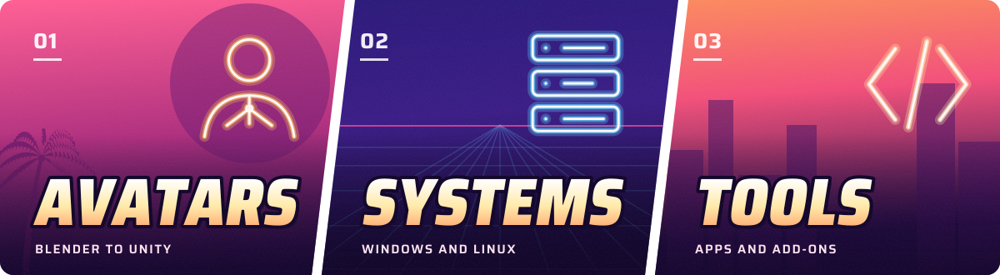

  

  I'm El Diablo, a developer and avatar architect. 
  I work on systems and networking, and I build avatars in Blender and Unity.

  

  <table>
    <tr>
      <th align="left">Avatars</th>
      <td>Blender to Unity. Sculpting, rigging, weights and shaders.</td>
    </tr>
    <tr>
      <th align="left">Systems</th>
      <td>Windows and Linux. Networking and the layers underneath.</td>
    </tr>
    <tr>
      <th align="left">Tools</th>
      <td>Desktop apps and Blender add-ons I build for my own workflow.</td>
    </tr>
  </table>

  
  
  
  
  
  
  
  

 

  

  Most of my work sits in private repos for now. Public releases will show up on this page.

